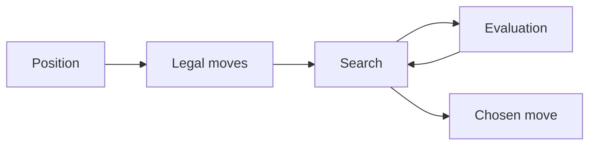

A chess engine is a useful excuse to ask a deceptively simple question: _what makes one move better than another?_ Before bitboards, opening books, or clever pruning, there is a board, a set of legal moves, and a way to compare positions.

This example outlines a first implementation. It is a design sketch, not a report of a completed engine or measured playing strength.

## Start with a small contract

Keep the rules separate from the search. The rules layer should answer three questions: whose turn is it, what moves are legal, and what position follows a move? A useful early boundary looks like this:

```typescript
interface Position {
  legalMoves(): Move[];
  play(move: Move): Position;
  isTerminal(): boolean;
}

type Move = { from: number; to: number; promotion?: string };
```

The interface leaves board representation open. Start with an ordinary array if that makes it easier to inspect. Optimising the representation before the move generator is correct tends to make mistakes harder to see.

## Look ahead, then evaluate

Minimax alternates between choosing the best result for one player and the worst result for the other. Negamax expresses the same idea using scores from the current player’s perspective:

```typescript
function negamax(position: Position, depth: number): number {
  if (depth === 0 || position.isTerminal()) {
    return evaluate(position); // Includes mate and draw scores.
  }

  let best = -Infinity;
  for (const move of position.legalMoves()) {
    const score = -negamax(position.play(move), depth - 1);
    best = Math.max(best, score);
  }
  return best;
}
```

This is illustrative code: `evaluate` needs a concrete implementation, including terminal positions. A material-only evaluation can be a starting point, but it will miss positional details and tactical threats beyond the search horizon.

If a position has roughly $b$ legal moves and the search visits $d$ plies, the rough leaf count grows as $b^d$. That exponential growth explains why reducing unnecessary work matters so much.

## Keep the loop visible

The first architecture can stay deliberately small:



Each box suggests a place to test independently. Move generation deserves known-position move counts. Evaluation deserves positions with obvious material differences. Search deserves tiny, synthetic trees with an unambiguous best move.

## Improve one thing at a time

Once the basic loop works, alpha-beta pruning can avoid searching branches that cannot change the answer. Move ordering helps it cut off earlier. Iterative deepening makes time management more practical.

| Step        | Question to answer                                        |
| ----------- | --------------------------------------------------------- |
| Legal moves | Are the rules correct, including check and special moves? |
| Evaluation  | Are scores consistent from the side-to-move perspective?  |
| Search      | Does it find forced outcomes on small trees?              |
| Pruning     | Does the result match an unpruned search?                 |

The point of an early engine is not to be impressive. It is to make the relationship between representation, correctness, and computation concrete.

> A slower engine you understand is a better starting point than a fast engine you cannot explain.
